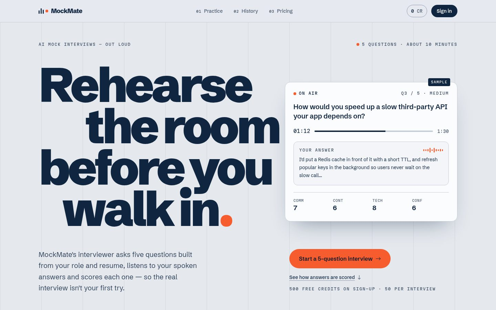
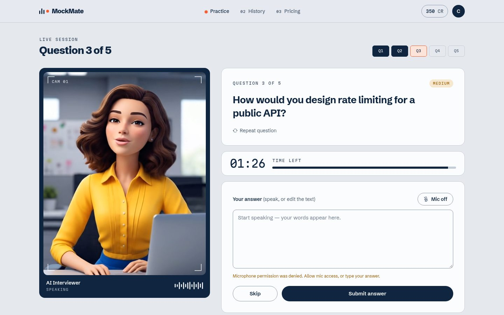
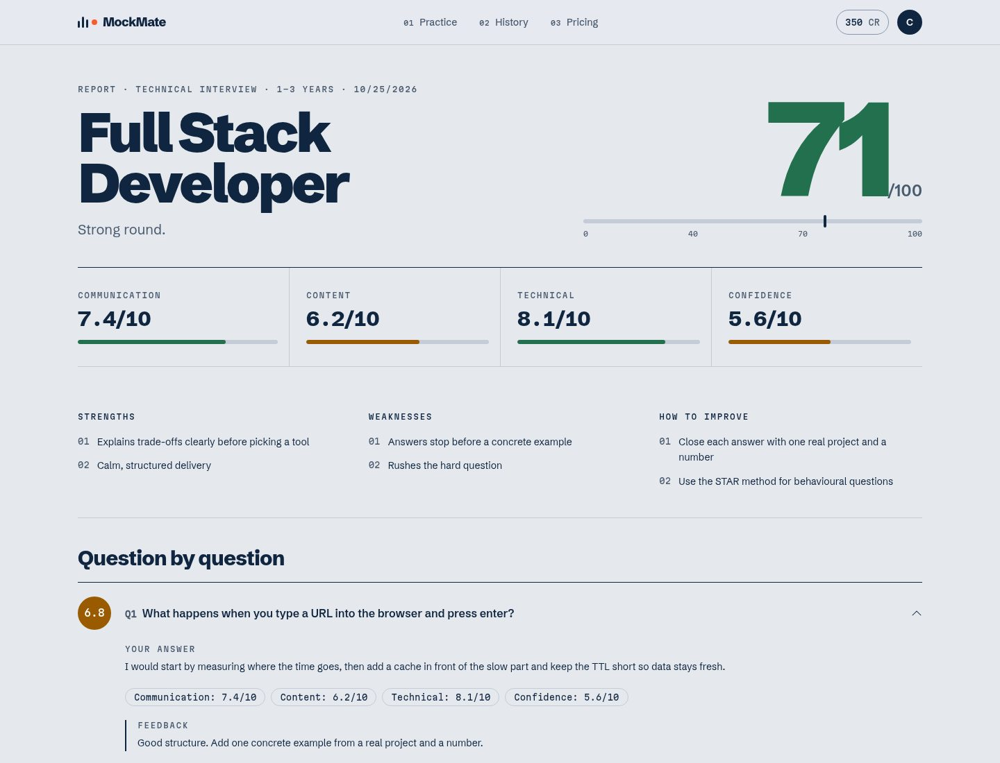
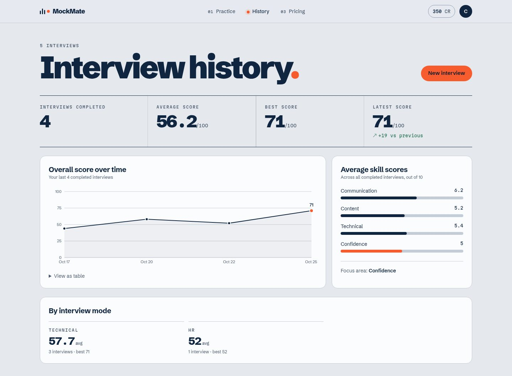

# MockMate — AI mock interviews, out loud

Practise job interviews with an AI interviewer. Sign in, upload your resume, pick a role, experience level and mode (HR / Technical / Confidence), answer questions by voice, and get a scored report with feedback.



## ✨ Features

| | Feature |
|---|---|
| 🎙️ | **Voice interview** — the AI interviewer speaks 5 questions (easy → hard) with a timer; you answer out loud. Works in every modern browser (Web Speech API, Groq Whisper + Orpheus fallback) |
| 📄 | **Resume-aware questions** — upload a PDF and questions come from your own projects |
| 🧭 | **3 modes** — Technical, HR, Confidence, each with its own scoring weights |
| 📊 | **Scoring** — every answer scored 0–10 on communication, content, technical, confidence + feedback; final report out of 100 with PDF export |
| 📈 | **History & analytics** — score trend, skill averages, weakest skill, per-mode stats |
| 💳 | **Credits** — 500 on sign-up, 50 per interview, packs via Razorpay (race-safe, idempotent) |
| 🔐 | **Auth** — Google (Firebase) or email + password with verification, httpOnly JWT cookie |
| ⚙️ | **Production setup** — BullMQ job queue, Redis rate limits + cache, zod validation, 83 tests in CI, deployed on Vercel + Render |

| Live interview | Report | History |
|---|---|---|
|  |  |  |

## 🧱 Tech stack

| Part | Tech |
|---|---|
| Frontend (`client/`) | React 19, Vite, Tailwind CSS 4, Redux Toolkit, React Router 7, Firebase Auth, motion |
| Backend (`server/`) | Node.js 22, Express 5 (ES modules), MongoDB + Mongoose, JWT, bcryptjs, zod, nodemailer |
| AI | Groq (`openai/gpt-oss-120b`, very fast) or OpenRouter (`anthropic/claude-haiku-4.5`) — `AI_PROVIDER` picks |
| Voice | Browser Web Speech API where it works well (Chrome / Edge / Safari) · Groq fallback for other browsers: Whisper (speech → text) and Orpheus (natural interviewer voice) |

## 📁 Project structure

```
Ai_interview_Agent/
├── client/                 React app
│   └── src/
│       ├── api/            all server calls (axios instance + one file per feature)
│       ├── components/     Navbar, ProtectedRoute, interview steps...
│       ├── pages/          one file per route (lazy-loaded)
│       ├── redux/          store + userSlice (userData, loading)
│       └── utils/          firebase, getErrorMessage
├── server/                 Express API
│   └── src/
│       ├── app.js          middleware order + routes
│       ├── server.js       DB connect, listen, graceful shutdown
│       ├── config/         env (zod-validated), db, cookie, token, firebaseAdmin
│       ├── middlewares/    isAuth, validate, rateLimit, errorHandler, upload
│       ├── modules/        one folder per feature: routes → controller → service → model (+ schema)
│       ├── lib/            ai (OpenRouter), mail (nodemailer)
│       └── utils/          AppError, sendSuccess
├── render.yaml             Render Blueprint (API + workers + Key Value Redis)
├── client/vercel.json      Vercel: /api proxy to Render + SPA fallback
├── PRD.md                  product plan + progress tracker
└── CLAUDE.md               working rules and code conventions
```

## 🚀 Run locally

**Needs:** Node.js 22+, a MongoDB database (local or [Atlas](https://www.mongodb.com/atlas)), a Firebase project with Google sign-in enabled, Docker (for Redis).

```bash
# 1. install
npm install                      # root: Prettier
npm install --prefix server
npm install --prefix client

# 2. env files — copy and fill in (see tables below)
cp server/.env.example server/.env
cp client/.env.example client/.env

# 3. Redis (rate limits + cache + job queue) on port 6380
docker compose up -d

# 4. run (three terminals)
cd server && npm run dev         # http://localhost:8000/ready → {"status":"ready","db":"ok","redis":"ok"}
cd server && npm run dev:worker  # background AI jobs (resume parsing, final report) + cleanup every minute
cd client && npm run dev         # http://localhost:5173
```

### `server/.env`

| Variable | Required | Example / notes |
|---|---|---|
| `PORT` | no | `8000` |
| `NODE_ENV` | no | `development` or `production` |
| `MONGODB_URL` | **yes** | `mongodb+srv://...` |
| `MONGO_POOL_SIZE` | no | `50` |
| `JWT_SECRET` | **yes** | long random string, 16+ characters |
| `CLIENT_URL` | no | `http://localhost:5173` (comma-separated for several) |
| `FIREBASE_PROJECT_ID` | **yes** | your Firebase project id |
| `AI_PROVIDER` | no | `openrouter` (default) or `groq` |
| `GROQ_API_KEY` | when `AI_PROVIDER=groq` | from console.groq.com |
| `GROQ_MODEL` | no | `openai/gpt-oss-120b` |
| `GROQ_WHISPER_MODEL` | no | `whisper-large-v3-turbo` — voice typing in Firefox/Brave/etc. (uses `GROQ_API_KEY`; no key → those browsers type) |
| `GROQ_TTS_MODEL` | no | `canopylabs/orpheus-v1-english` — interviewer voice where the browser only has robotic voices (accept the model terms once in the Groq console) |
| `GROQ_TTS_VOICE_FEMALE` / `GROQ_TTS_VOICE_MALE` | no | `hannah` / `troy` (others: autumn, diana · austin, daniel) |
| `OPENROUTER_API_KEY` | when `AI_PROVIDER=openrouter` | from openrouter.ai |
| `OPENROUTER_MODEL` | no | `anthropic/claude-haiku-4.5` |
| `SMTP_HOST` / `SMTP_PORT` / `SMTP_USER` / `SMTP_PASS` | production only | Gmail: `smtp.gmail.com`, `587`, your Gmail, a 16-char [App Password](https://myaccount.google.com/apppasswords). Empty in dev → emails are printed in the server terminal |
| `MAIL_FROM` | no | `MockMate <you@gmail.com>` |
| `RAZORPAY_KEY_ID` / `RAZORPAY_KEY_SECRET` / `RAZORPAY_WEBHOOK_SECRET` | no | Razorpay Test Mode keys. Empty → buying credits is disabled |
| `REDIS_URL` | **yes** | `redis://localhost:6380` (from `docker compose up -d`). Rate limits, cache and the job queue |
| `WORKER_CONCURRENCY` | no | `10` — AI jobs one worker runs at the same time |
| `RUN_WORKER_IN_API` | no | `false`. `true` = the API process also runs the job workers (used on Render's free plan) |
| `TRUST_PROXY_HOPS` | no | `1`. Production only: proxies in front of the server (Vercel proxy + Render = `2`) |
| `LOG_LEVEL` | no | `info` (`debug` for more detail) |
| `SENTRY_DSN` | no | error monitoring. Empty → off |

The server checks these at startup and refuses to start with a clear list if something is missing or wrong.

### `client/.env`

| Variable | Notes |
|---|---|
| `VITE_FIREBASE_API_KEY` | Firebase web API key |
| `VITE_SERVER_URL` | `http://localhost:8000`. **Leave unset on Vercel** (calls go to `/api` on the same site) |
| `VITE_SENTRY_DSN` | optional error monitoring. Empty → off |

## 🌍 Deploy (Vercel + Render + Atlas)

```
Browser ──HTTPS──> Vercel  (React build; /api/* is proxied ↓ — so the login cookie is first-party, works in Safari)
                     └──> Render web service "interviewiq-api"  (API + job workers in one process, free plan)
                             ├──> MongoDB Atlas (M0 free)
                             └──> Render Key Value "interviewiq-redis" (rate limits, cache, BullMQ queue)
```

Free-plan trade-off: the Render service sleeps after 15 min without traffic, the first request then takes ~50 s.
Later (paid): set `RUN_WORKER_IN_API=false` and enable the worker service at the bottom of `render.yaml`.

**1. MongoDB Atlas**
1. Create a free **M0** cluster in Mumbai or Singapore (close to Render's `singapore` region).
2. Database Access → add a user. Network Access → allow `0.0.0.0/0` (Render's free plan has no fixed IP).
3. Connect → Drivers → copy the `mongodb+srv://...` URL and put a database name in it (`.../ai_interview?...`).

**2. Render (server + Redis)**
1. Render → **New → Blueprint** → pick this GitHub repo. It reads `render.yaml` and creates both services.
2. Fill the secrets it asks for: `MONGODB_URL`, `FIREBASE_PROJECT_ID`, `GROQ_API_KEY`, `SMTP_USER`, `SMTP_PASS`,
   `MAIL_FROM`, Razorpay keys, `SENTRY_DSN` (optional ones can stay empty). Put `CLIENT_URL` = `https://placeholder.vercel.app`
   for now — you get the real URL in step 3.
3. Check `https://interviewiq-api.onrender.com/ready` → `{"status":"ready","db":"ok","redis":"ok"}`.
   If Render gave the service a different URL, change it in `client/vercel.json`.

**3. Vercel (client)**
1. Vercel → **Add New → Project** → this repo → **Root Directory: `client`** (Vite is detected automatically).
2. Environment variables: `VITE_FIREBASE_API_KEY` (and `VITE_SENTRY_DSN` if you use it). **Do not set `VITE_SERVER_URL`.**
3. Deploy → copy the URL (`https://<name>.vercel.app`) → Render → `CLIENT_URL` → save (Render redeploys).

**4. Firebase + Razorpay**
- Firebase console → Authentication → Settings → **Authorized domains** → add `<name>.vercel.app` (otherwise the Google popup fails).
- Razorpay → Webhooks → `https://interviewiq-api.onrender.com/api/payment/webhook`, events `payment.captured` +
  `payment.failed`, the secret = `RAZORPAY_WEBHOOK_SECRET`.

**5. Test it live**
1. `https://<name>.vercel.app/api/user/current-user` → 401 JSON from our server (the proxy works).
2. Google login → refresh the page → still logged in (cookie works).
3. Upload a resume → start an interview → finish → the report appears (the queue + workers work).

## 🛠️ Scripts

| Where | Command | Does |
|---|---|---|
| root | `npm run format` | Format all code with Prettier |
| root | `npm run format:check` | Check formatting without changing files |
| root | `npm run lint` | ESLint for client and server |
| root | `npm run check` | Format check + lint + client build — run before committing |
| root | `npm test` | All server + client tests (needs Redis: `docker compose up -d`) |
| server / client | `npm test` / `npm run test:watch` | Run tests once / re-run on every save |
| server | `npm run dev` | Start API with auto-restart (nodemon) |
| server | `npm run dev:worker` / `npm run worker` | Start the background job worker (dev with auto-restart / production) |
| client | `npm run dev` / `npm run build` | Vite dev server / production build |

## 🧪 Tests & CI

- **Server** (`server/test/`, Vitest + Supertest): real HTTP requests against the Express app, a temporary in-memory MongoDB (`mongodb-memory-server`, replica set for transactions) and Redis DB 1 (your dev data in DB 0 is never touched). The AI and email are faked, so tests are fast, free and repeatable. Covers auth, the credits race (10 parallel starts with credits for 1), ownership, the job queue (incl. retries), payments (signatures, idempotent webhook, verify/webhook race) and the cleanup job.
- **Client** (`client/src/**/*.test.jsx`, Vitest + Testing Library + jsdom): Setup page, Report page, job polling.
- **CI** (`.github/workflows/ci.yml`): on every push / pull request GitHub runs format check → lint → server tests (with a Redis service) → client tests → build.

## 🔌 API (so far)

All responses look like `{ success, message, data }`. Errors may include a `code` (e.g. `EMAIL_NOT_VERIFIED`).

| Method | Path | Auth | Purpose |
|---|---|---|---|
| POST | `/api/auth/google` | – | Log in with a Firebase ID token |
| POST | `/api/auth/register` | – | Create an email/password account (sends verification link) |
| POST | `/api/auth/verify-email` | – | Verify email from the link → logged in |
| POST | `/api/auth/resend-verification` | – | Send a new verification link |
| POST | `/api/auth/login` | – | Email + password login |
| POST | `/api/auth/forgot-password` | – | Email a password-reset link |
| POST | `/api/auth/reset-password` | – | Set a new password from the link → logged in |
| POST | `/api/auth/logout` | – | Clear the login cookie |
| GET | `/api/user/current-user` | cookie | The logged-in user |
| GET | `/health` | – | Uptime check |

Login, register, resend and password routes are limited to 10 attempts per 15 minutes per IP; everything else to 100 requests per minute.
